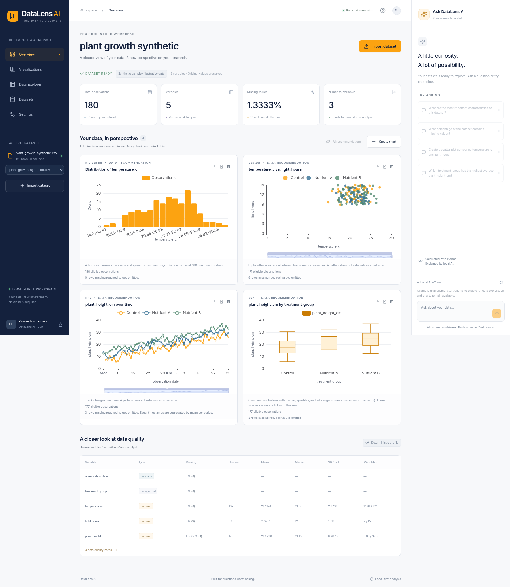

# DataLens AI

**From Data to Discovery.** A local scientific workspace for CSV exploration, interactive visualizations, and a Qwen3 assistant grounded in actual Python calculations.

Built with Next.js App Router, React, TypeScript, Tailwind CSS, customized shadcn/ui + Radix components, Lucide, ECharts, TanStack Table and Zod; FastAPI, Pydantic, Pandas, NumPy, DuckDB and SciPy; Ollama with **Qwen3-4B**. No paid API or cloud account is required.

## Run locally

Requirements: **Node.js 24 LTS**, **Python 3.12+**, [uv](https://docs.astral.sh/uv/getting-started/installation/), and optionally [Ollama](https://ollama.com/download). A modern Chromium/Firefox/Safari browser is recommended. AI benefits from roughly 8 GB of available RAM (16 GB system RAM is more comfortable), several GB of free disk, and optionally a supported GPU. CPU inference works but may be slow. The data workspace runs without Ollama.

```bash
git clone https://github.com/NightTapes/Oblig-2-GenAI.git
cd Oblig-2-GenAI
cp .env.example backend/.env
cp frontend/.env.example frontend/.env.local
```

Terminal 1 — backend:

```bash
cd backend
uv sync --frozen
uv run uvicorn app.main:app --host 127.0.0.1 --port 8000
```

Terminal 2 — frontend:

```bash
cd frontend
npm ci
npm run dev
```

Open **[localhost:3000](http://localhost:3000)**. API docs: **[localhost:8000/docs](http://localhost:8000/docs)**. Use one frontend hostname consistently; cookies belong to the browser host. Next.js proxies `/api` to FastAPI so browser requests are same-origin.

Terminal 3 — enable local AI:

```bash
ollama serve
# In another terminal, if the desktop Ollama app is already running, skip serve:
ollama pull qwen3:4b
```

Refresh the assistant's connection indicator. The first question may load the model into memory; subsequent questions are typically quicker. Increase `AI_TIMEOUT_SECONDS` for slower computers. Data exploration, profiling, manual charts and exports remain usable while the model is offline.

## Explore

1. Drop a CSV or load one of the two **clearly labeled synthetic** sample datasets.
2. Inspect rows, variables, missing-cell percentages and descriptive statistics.
3. Explore automatically selected histograms, scatter plots, lines and box plots.
4. Choose **Create chart** for any compatible histogram, scatter, line, aggregated bar, box plot or Pearson heatmap. Use the card's PNG/SVG buttons to export.
5. Use **Data Explorer** to search, sort and paginate the complete original records.
6. Ask the local assistant a standalone question. Verified results appear separately from AI-generated explanations. AI-created charts appear in the workspace.

Examples for the plant sample:

- “Which treatment group has the highest average plant height?”
- “Create a scatter plot comparing temperature and plant height.”
- “What percentage of the dataset contains missing values?”
- “What are the most important characteristics of this dataset?”

For the environmental sample: “Is there a correlation between temperature and humidity?” Questions are resolved against the active dataset; answers are not hardcoded. AI recommendations are requested explicitly with **AI recommendations**, which invokes dataset understanding and chart selection. Invalid recommendations fall back to the deterministic engine.

## Trust and data semantics

- Original CSV cell strings remain intact in the explorer, including leading zeros and original date formatting. A separate typed view powers analysis.
- Empty and whitespace-only cells count as missing. Literal `NA`, `null` and similar strings are preserved as text. Clean these explicitly before upload if a different missing-value policy is needed.
- Common comma, semicolon, tab and pipe delimiters and UTF-8/BOM/recognized legacy encodings are supported. Malformed records, duplicate/blank headers, binary files and over-limit imports are rejected; no rows or columns are silently discarded.
- Numeric inference requires every nonmissing value to be numeric and finite. Mixed columns remain text. Review inferred identifiers (e.g. numeric-looking codes) and dates before interpretation. Dates use Pandas mixed-format parsing and UTC normalization; ambiguous day/month formats should be made ISO 8601 in the source file.
- Standard deviations use **n−1**. One-observation or numerically undefined statistics appear as unavailable. Constant and empty columns are flagged.
- Calculations use **all eligible observations** and exclude only rows missing required variables. Pearson r reports the actual coefficient and complete-pair sample size, requires at least three pairs and nonconstant variables, and describes linear association. It does not establish causality or significance; nonlinear patterns and outliers may make Pearson r inappropriate.
- Histograms aggregate all eligible values. Box plots use quartiles with **minimum/maximum whiskers**, not Tukey whiskers. Bars use the selected aggregation and start from zero. Time charts aggregate duplicate timestamps by the selected operation per group. Scatter display samples are reproducible (seed 42); line display downsampling preserves chronological order. Display limits are disclosed and do not change statistical calculations.
- Grouped charts/analyses are limited to 40 groups. Heatmaps use the first 16 numeric columns; complete-pair sample sizes appear in the method note. Category profile distributions show the top 12 values. These limits are explicit, not statistical sampling.

## How AI works

```text
Question + column metadata
          ↓
Ollama / Qwen3-4B → strict JSON action
          ↓
Pydantic + column/type/operation validation
          ↓
Predefined Python / DuckDB / SciPy calculation
          ↓
Verified result → Qwen explanation + optional validated chart
```

The action allowlist contains dataset/column descriptions, missing-value summaries, numeric aggregation, descriptive group comparisons, Pearson correlation and chart creation. Arbitrary Python, shell commands and AI-authored SQL are never executed. DuckDB queries use fixed table/column aliases and allowlisted functions. Qwen receives only bounded metadata and verified results, never entire datasets or raw row samples. Dataset text is treated as untrusted content. Separate prompts handle understanding, recommendations, action selection and explanations. Ollama receives a JSON schema for every phase, including result explanations, low-temperature sampling, `think: false`, and Qwen’s documented `/no_think` prompt marker for compatibility. Reasoning is never combined with final content; the final response is validated before use. A bounded compatibility retry omits the API flag only when an older server explicitly rejects that flag.

Explanations can still be wrong even when calculations are right. The verified result and method notes are the source of truth. If explanation generation fails after calculation, verified results remain visible. Unsupported or ambiguous questions return a clarification/limitation instead of fabricated analysis. Each question is standalone; previous conversation text is displayed but not used as analytical state.

## Troubleshooting the AI assistant

The refresh button checks whether the configured model is **installed**. It does not run an inference test. If you see a verified result followed by an explanation error, Ollama already selected an action and Python already completed the calculation; the explanation phase failed separately.

For local development, run the following **from `backend/`**, in the same environment as FastAPI:

```bash
uv run python ../scripts/check_ai.py
```

This prints the effective local URL, model, Ollama version and limits, then runs a tiny disposable dataset through real action selection, Python calculation and explanation. It does not use mocks or your uploaded records. Expected group means are A = 2 and B = 6. A successful test ends with `PASS`. If it fails, it prints the specific failing category. Keep Ollama up to date for Qwen3 non-thinking/structured-output support.

- **Cannot communicate with Ollama:** run `ollama serve` and check `OLLAMA_URL` in `backend/.env`. FastAPI and Ollama must be reachable from the same environment. A working VS Code terminal in Windows does not establish reachability from WSL, a dev container or Docker. Native development defaults to `http://127.0.0.1:11434`; a container using host Ollama needs the documented `host.docker.internal` configuration.
- **Missing model:** run `ollama list` and `ollama pull qwen3:4b`. Set `OLLAMA_MODEL` to the exact installed tag.
- **Output token limit / no final answer:** update Ollama and retry. The assistant requests non-thinking mode at both the API and prompt levels and constrains explanations to JSON. If needed, set `AI_MAX_OUTPUT_TOKENS=4096` in `backend/.env` (the supported maximum).
- **Timeout:** first inference can load model weights and CPU generation can take longer. Set `AI_TIMEOUT_SECONDS=180` if needed.
- **HTTP 400/500 or invalid structured response:** inspect the Ollama terminal and the FastAPI terminal. The backend records the phase and failure category without logging your question, dataset text or model reasoning. Memory/model-loading errors belong to Ollama; structured-response errors are identified separately.

After changing backend settings or switching branches, **restart FastAPI**. Restart the frontend as well; if using a production build, rebuild it before starting. With Compose, use `docker compose --profile ai up --build -d` and keep `COMPOSE_OLLAMA_URL` pointed at the intended Ollama service. Existing environment files are preserved by Git, so add new variables manually if you want to override their defaults. Verified numerical results remain visible if explanation generation fails; **Retry question** retries the full question.

## Docker Compose (optional)

Requires Docker Engine/Desktop and Compose v2. The frontend is bound to loopback; backend and Ollama are internal services. Model weights are a separate download.

```bash
# Full stack with a CPU Ollama service:
docker compose --profile ai up --build -d
docker compose --profile ai exec ollama ollama pull qwen3:4b
# Open http://localhost:3000
```

Without AI:

```bash
docker compose up --build -d
```

With an existing host Ollama:

```bash
COMPOSE_OLLAMA_URL=http://host.docker.internal:11434 docker compose up --build -d
```

On Linux, `extra_hosts` supplies the host gateway. The host Ollama listener must be reachable from Docker (configure its bind address as needed and restrict it with your local firewall). Do not expose Ollama publicly. Compose does not provision GPU support; native host Ollama is the recommended path for hardware acceleration. To stop containers: `docker compose --profile ai down`. The named volume retains downloaded models; datasets are temporary backend files.

In a corporate/managed environment, Docker builds may need the proxy CA supplied as a BuildKit secret named `proxy_ca`. Both Dockerfiles support it without baking the certificate into images. Keep TLS verification enabled. Ordinary local Docker builds need no secret.

## Configuration

Backend variables are documented in [.env.example](.env.example). Local `uvicorn` reads `backend/.env` when started from `backend/`. Compose uses the repository root `.env` for interpolation.

| Variable | Default | Purpose |
|---|---|---|
| `OLLAMA_URL` | `http://127.0.0.1:11434` | Only loopback, `ollama`, or `host.docker.internal` hosts are accepted |
| `OLLAMA_MODEL` | `qwen3:4b` | Local model name |
| `AI_TIMEOUT_SECONDS` | `90` | Timeout per model call |
| `AI_MAX_OUTPUT_TOKENS` | `2048` | Maximum generated tokens per call (256–4096) |
| `MAX_UPLOAD_MB` | `20` | File limit; multipart request also has a strict body cap |
| `MAX_ROWS` / `MAX_COLUMNS` | `200000` / `100` | Import computation bounds |
| `CHART_POINT_LIMIT` | `2000` | Scatter/line display limit |
| `MAX_SESSION_DATASETS` / `MAX_DATASETS` | `5` / `100` | Per-session and server dataset caps |
| `MAX_STORE_MB` | `500` | Bound on retained serialized datasets |
| `DATASET_TTL_SECONDS` | `7200` | Fixed dataset lifetime after import |
| `DATA_DIR` | `/tmp/datalens-datasets` | Parent for unique process-owned storage directories |
| `CORS_ORIGINS` | localhost/127.0.0.1:3000 | Exact allowed browser origins |
| `COOKIE_SECURE` | `false` | Set true behind HTTPS |

Frontend variables are documented in [frontend/.env.example](frontend/.env.example). `API_INTERNAL_URL` is the server-side API proxy target and is compiled into rewrites at build time. `NEXT_PUBLIC_API_URL` optionally bypasses the proxy; the default empty value is recommended. `PROXY_BODY_LIMIT_MB` defaults to `25` and must exceed the backend upload limit, including multipart overhead; restart/rebuild after changing it. Keep the default 20 MB limit with the supplied Compose build, or configure and rebuild both layers together.

## Tests

```bash
cd backend
uv sync --frozen
uv run pytest -q

cd ../frontend
npm ci
npm run typecheck
npm test
npm run build
npx playwright install chromium
npm run test:e2e
```

Browser tests start the real API and the production frontend automatically. On Linux with system Chromium, set `PLAYWRIGHT_CHROMIUM_EXECUTABLE_PATH=/usr/bin/chromium` instead of downloading a browser. The tests cover CSV import, profiles, real charts, manual chart configuration, PNG/SVG downloads, table filtering/sorting/pagination, sample loading and mobile navigation/assistant access. Backend tests mock **only the model HTTP boundary** for deterministic AI orchestration, so actual schema validation and numerical calculations still run. CI runs Python tests, frontend tests, type checks, the production build and Playwright.

See [DEVELOPMENT.md](DEVELOPMENT.md) for the verified delivery results, known limits and the manual **real Qwen3** acceptance procedure.

## API

FastAPI's `/docs` and `/openapi.json` describe the schemas. Errors use `{ "error": { "message": "…", "code": 422 } }`; validation errors also include safe field descriptions.

```text
GET    /api/health
GET    /api/ai/status
GET    /api/datasets
POST   /api/datasets/upload           multipart file
POST   /api/datasets/sample           {name: "plants" | "environment"}
GET    /api/datasets/{id}/profile
GET    /api/datasets/{id}/rows         page, page_size, search, sort, descending
GET    /api/datasets/{id}/recommendations?use_ai=false
POST   /api/datasets/{id}/analyze      validated AnalysisAction
POST   /api/datasets/{id}/charts       validated ChartSpec
POST   /api/datasets/{id}/chat         {message: "…"}
DELETE /api/datasets/{id}
```

## Privacy, isolation and limits

Uploads are processed **on the backend server**, not exclusively in the browser. With local deployment this is your own computer. If you move the backend elsewhere, that server receives the files.

The server issues an unpredictable HttpOnly, SameSite cookie and checks server-side dataset ownership on every read, analysis, chart, chat and delete. Dataset IDs alone do not authorize access. Sessions and dataset metadata are process-local: **run one backend worker**. Session cookies are bearer credentials, not authenticated user accounts. Tabs on the same origin share a session. Limits include request bodies, 120 requests/minute/session, 8 concurrent requests, 2 concurrent model generations, total stored bytes and dataset TTL. Worker threads keep bounded calculations off the event loop; these are input/resource bounds, not an OS sandbox or hard CPU preemption.

Expired files are removed on access and by a 30-second cleanup task; graceful shutdown removes the process directory. An abrupt crash can leave an orphan process directory in `DATA_DIR` until the OS clears temporary storage; it is never reloaded. Chart arrangements and conversation history are browser memory, reset when switching datasets/reloading. Data survives frontend refresh within the same live backend/session, but not a backend restart.

This is a trusted-local university MVP. It has no accounts, encryption at rest, durable persistence, audit log, cross-host isolation, distributed storage or public-service abuse protection. Public deployment requires a separate security review, authenticated access, HTTPS, operational limits and storage lifecycle work.

## Repository

```text
frontend/src/app/             App Router, design system and responsive styles
frontend/src/components/      Dashboard, charts, dataset explorer, AI assistant, UI primitives
frontend/src/lib/             Typed API client and Zod chart schema
backend/app/data/             CSV parsing, profiles and session-owned temporary store
backend/app/analysis/         Allowlisted deterministic operations
backend/app/visualization/    Chart validation, data preparation and recommendations
backend/app/ai/               Task-specific prompts and local Ollama client
backend/app/schemas/          Strict Pydantic request/response schemas
sample_data/                 Seeded synthetic plant and environmental datasets
scripts/                     Sample generation and check helpers
```

## Licenses

Project code is MIT licensed. Dependencies are free/open source: Next.js/React/Tailwind/shadcn/Radix/TanStack/Zod/FastAPI/DuckDB/uv (MIT or MIT/Apache-2.0), Lucide (ISC), ECharts and Qwen3-4B weights (Apache-2.0), Pandas/NumPy/SciPy (BSD), Inter (SIL Open Font License), and Ollama (MIT). Upstream notices and license terms remain applicable. Model weights are downloaded separately through Ollama, never bundled in this repository. Synthetic data is generated by the included seeded script.

## Screenshots

The real workspace with the included synthetic plant dataset:



[Welcome screen](docs/screenshots/welcome.png) · [Mobile view](docs/screenshots/mobile.png)
